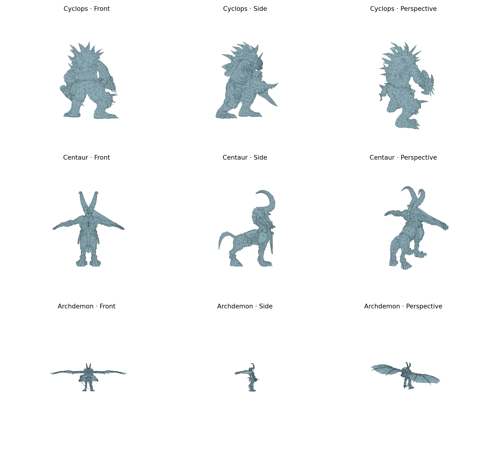

# Xbox character geometry: 2026-11-05 findings

The primary Cyclops, Centaur and Archdemon assemblies are recognizable in front,
side and perspective OBJ renders. This is a geometry milestone, **not complete
PAK extraction**. The Android export uses the same Java class exercised by the
desktop harness. Original PAKs and extracted OBJs are not committed here.



## Correction to earlier research

The old `type/subtype/capacity/count` scan conflated nested array headers with a
primitive enum. After a length-prefixed resource name, an optional `(4,0)` prefix
is followed by a draw-container allocation/count pair. The count is the number
of batches, not a list/strip selector. Each batch contains:

1. An allocation/count pair and that many uint16 triangle-list indices.
2. An allocation/count pair for a collection of triangle strips. Every strip has
   its own allocation/count pair and uint16 indices.
3. An allocation/count pair and a uint16 auxiliary table (called a palette in
   diagnostics; its runtime semantics remain unverified).
4. A zero trailer in these samples.

Some resources have additional consecutive draw containers. For example, the
Centaur head has three batches across multiple containers. Scanning only names
or interpreting every apparent header as a separate list omitted these batches.
Strip winding alternates across every input position, including degenerate
stitching indices. List counts must divide by three; bad ranges reject the
resource instead of silently dropping out-of-range triangles.

Vertex buffers have allocation/count fields, contiguous 32-byte records, a
16-byte zero trailer and a subsequent repeated total count. Discovery checks
these fields and finite XYZ/UV values at every byte alignment. XYZ occupies
bytes 0–11 and UV occupies bytes 16–23. Other vertex fields are preserved only
in the source; packed normals, weights and bone fields are not decoded.
Coordinates are exported unchanged (Y up); OBJ texture V is flipped. No
character-specific archive offsets or CSV inputs are required.

The implementation supports the observed allocation powers 128–65536 and vertex
counts over 100. Smaller buffers and other serialization layouts are explicitly
outside current discovery coverage. A character mesh path bounds associations,
so Centaur's earlier weapon resources cannot be mapped to its body buffer.

## Verified primary assemblies

| Archive | Vertex records | Referenced records | Triangles | Assembly |
| --- | ---: | ---: | ---: | --- |
| Cyclops | 5,088 | 5,088 | 6,974 | Body plus armor/rigid buffer |
| Centaur | 6,735 | 6,121 | 6,832 | Main LO body plus armor/rigid buffer |
| Archdemon | 8,081 | 7,203 | 7,108 | Main DC body plus armor/rigid buffer |

Topology audits still report open/nonmanifold edges and unusually long edges:

| Assembly | Boundary edges | Nonmanifold edges | Faces with an edge over 5× global median |
| --- | ---: | ---: | ---: |
| Cyclops | 2,910 | 40 | 21 |
| Centaur | 5,441 | 187 | 253 |
| Archdemon | 6,944 | 265 | 1,090 |

Seams, separate parts and large wing polygons can contribute to these metrics,
but their causes have not all been resolved. No automatic welding, face deletion
or cosmetic mesh repair was used to hide them. Visual recognizability does not
establish watertightness, exact in-game appearance or complete geometry.

Counts describe serialized records, including seam duplicates; they are not
welded vertex counts. Centaur and Archdemon have additional unreferenced records.
Their purpose may involve morphs, but that is not established. See the JSON
audits for exact resource boundaries, batch counts and reference coverage, and
`validated_archives.json` for archive hashes and every supported buffer's totals.

Meshes with matching serialized variant names and mesh source are assembled;
individual buffers are always exported too. Low-detail names are separated.
Mixed-name buffers, including one Archdemon low-detail buffer, are preserved
without automatic assembly. Alternate LC/DO armor and frozen meshes are not
claimed to be complete standalone characters. A matching name is not proof of
all possible runtime assembly rules.

## Reproduce

```sh
python3 research/wrath_geometry.py /path/to/character.pak --out /tmp/character
python3 research/render_geometry.py /tmp/character/assembled_file.obj --out /tmp/preview.png
python3 -m compileall -q research
python3 -m unittest discover -s research/tests -v
WRATH_PAK_DIR=/path/to/originals python3 -m unittest discover -s research/tests -v
```

Rendering requires NumPy and Matplotlib. Extraction and tests use Python's
standard library; tests also require Java 17 with the `jdk.compiler` module.
The Java source targets Java 8 bytecode for Android compatibility.

```sh
java com.sun.tools.javac.Main --release 8 -d /tmp/wrath-classes \
  app/src/main/java/com/wrath/pakviewer/WrathGeometry.java research/GeometryCli.java
java -cp /tmp/wrath-classes GeometryCli character.pak character.zip
```

All 13 tests pass with the three original archives present. Checks cover
relocated/unaligned buffers, nested containers, strip stitching/parity, malformed
counts/truncation/nonfinite coordinates, out-of-range rejection, OBJ assembly
rebasing, and Python/Android vertex and ordered-face parity for every discovered
character buffer. CI runs the synthetic tests; source archives stay local.

In Android, open a PAK and select **EXPORT CHARACTER GEOMETRY (OBJ ZIP)**. The ZIP
contains `buffers/`, `assembled/` and `geometry_audit.txt`. An unsupported file
produces an error rather than fake geometry. The existing audio/research exports
remain available.

## Still unresolved

- Textures/material binding, packed normals, rig/skeleton, skin weights and animation.
- Morph/expression records and unreferenced vertex records.
- Complete alternate-variant assembly and small/static/frozen-buffer layouts.
- PS2 format support and validation on additional Xbox characters.
- On-device Android UI/runtime validation; desktop execution verifies the exact
  extraction core, not Android document-provider behavior or phone memory limits.

The older candidate scripts remain historical hypotheses. In particular,
`centaur_triangle_list_correction.py` now parses again, but its all-list assumption
is superseded by this nested-container decoder.
