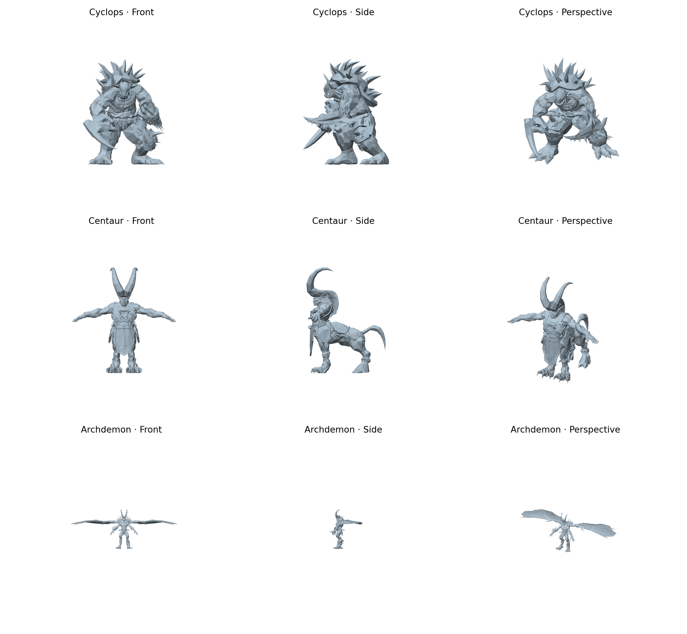

# Xbox character geometry (v2.0 mapping, v2.1 textured export)

Native texture decoding and exact-name MTL binding were added in v2.1. See
[TEXTURES.md](TEXTURES.md) for the current app/export behavior and textured previews.
The mapping findings below remain valid; the v2.0 ZIP layout is historical.

v2.0 fixes two actual export defects demonstrated by the shaded Android
screenshots: wrong vertex ranges for faces/eyes, and inside-out OBJ winding.
The main Cyclops, Centaur and Archdemon assemblies have been inspected in shaded
front, side and perspective views **with backface culling enabled**. The earlier
wireframe preview was insufficient to establish correctness.



## Corrected serialization and vertex mapping

Every named resource contains **two** draw-batch arrays, not an optional prefix
followed by an arbitrary number of containers:

1. Appended-vertex batches. Their indices are local to the appended vertex range.
2. Main-vertex batches. Their indices address the main vertex range.

An array begins with allocation/count uint32 fields. A zero first array appears
as `(4,0)`; v1.9 incorrectly skipped it as a generic prefix and interpreted a
nonzero first array against the main vertices. Both arrays must be consumed,
including empty arrays.

Every batch contains a uint16 triangle-list array, an array of independently
counted uint16 triangle strips, a uint16 auxiliary/palette array, and a zero
trailer. The allocation/count pairs are not topology enums. Strip winding
alternates across every input position, including degenerate stitching indices.
List counts must divide by three. Invalid indices reject the resource; they are
not silently dropped, including when the triangle would be degenerate.

Buffers have contiguous 32-byte records. XYZ is at bytes 0–11, and UV at bytes
16–23. After the records are 16 zero bytes, a **main vertex count**, and a repeated
**total vertex count**. The difference gives the appended range size. Appended
indices therefore need `main_vertex_count` added before indexing the records.

| Sample | Main records | Appended records | Previously broken resources |
| --- | ---: | ---: | --- |
| Centaur body buffer | 4,654 | 614 | Head, part of torso, eyes |
| Archdemon body buffer | 5,782 | 878 | Head/torso, eyes |
| Cyclops body buffer | 2,158 | 0 | No appended range in this buffer |

No character-specific offsets or corrective vertex shifts are used. The counts
come from each serialized buffer. All 13 discovered character buffers across the
three samples now reference **every** stored vertex record.

The semantics of the appended stream may involve facial deformation, but no rig
or morph animation is claimed. This change fixes its static geometry mapping.

## Winding, normals and assembly

The observed Xbox triangles use clockwise outward winding in the preserved
coordinate system. OBJ exports reverse each triangle to counterclockwise order.
The old exports' signed volume was negative; the corrected primary assemblies
have positive volume and recognizable surfaces with backface culling enabled.
Area-weighted vertex normals are generated from the corrected geometry and
written as `vn` records; faces use `v/vt/vn` references. These are generated
normals, not a claim to have decoded the packed source normal field. Separate
serialized vertices are retained, including seam/hard-edge duplicates.

Source coordinates remain Y up. OBJ texture V is flipped. The renderer uses a
right-handed display-axis transform and actual front-face selection; it does
not display both sides to conceal winding errors.

In Android, open a PAK and select **EXPORT CHARACTER GEOMETRY (OBJ ZIP)**:

- `models/primary_model.obj`: the primary matching-name body/armor assembly.
- `parts/`: separate buffers and material-name variants. These can be armor or
  attachments only and are explicitly **not** presented as complete models.
- `geometry_audit.txt` and `README.txt`: counts, boundaries and usage notes.

Different mesh sources and mixed variant names are not automatically merged.
Alternate-variant runtime composition remains unresolved. In particular, the
DO material-name export shown as disconnected armor in the supplied screenshot
was a parts export, not a decoded complete alternate character.

v2.0 also sets Android versionCode 20 / versionName 2.0, updates the visible title,
makes all controls/output accessible in a scrolling page, and captures the input
byte array for geometry export so loading a second PAK cannot change that job's
source halfway through.

## Results and remaining limitations

| Primary assembly | Records, all referenced | Triangles |
| --- | ---: | ---: |
| Cyclops | 5,088 | 6,974 |
| Centaur | 6,735 | 6,832 |
| Archdemon | 8,081 | 7,108 |

Archdemon head/torso 95th-percentile edge length fell from about 189 to 12.4 source
units. Its eye value fell from 191.8 to 2.3. Centaur head fell from 39.9 to 6.6,
and eyes from 33.2 to 1.4. These changes follow the serialized vertex mapping;
no triangle deletion or cosmetic repair was used to achieve them.

Open edges, seam duplication and some nonmanifold edges remain. Raw-index audits
report 40 nonmanifold edges for Cyclops, 2 for Centaur, and 59 for Archdemon.
Their full causes are not established. Wing polygons also produce long edges.
These are static geometry exports, not watertight printing meshes.

Still unfinished:

- Source shader behavior and complete alternate material binding. v2.1 now
  decodes native BC1/BC3 MTX records despite the absence of PNG/DDS signatures;
  see TEXTURES.md.
- Source packed normals, skeletons, weights, animation and morph animation.
- Complete alternate-variant assembly, smaller/static/frozen-buffer layouts,
  and PS2 format support.
- Android on-device validation of v2.0; desktop tests execute the exact Android
  extraction class, but do not exercise the phone document provider or UI.

This is a validated improvement to the three tested primary static models,
**not completion of all game-asset extraction**.

## Reproduce

```sh
python3 research/wrath_geometry.py /path/to/character.pak --out /tmp/character
python3 research/render_geometry.py /tmp/character/primary_model.obj --out /tmp/preview.png
python3 -m compileall -q research
python3 -m unittest discover -s research/tests -v
WRATH_PAK_DIR=/path/to/originals python3 -m unittest discover -s research/tests -v
```

Rendering requires NumPy and Matplotlib. Extraction uses Python's standard
library. Tests require Java 17 including `jdk.compiler` and compile the Android
core to Java 8 bytecode. Seventeen tests pass with the original archives present.
Checks cover relocated/unaligned buffers, both vertex ranges, bounds/truncation,
strip stitching/parity, CCW winding, generated unit normals, export organization,
OBJ rebasing and Python/Android ordered-face/vertex parity for all 13 buffers.
CI uses synthetic fixtures; original archives are not committed.

```sh
java com.sun.tools.javac.Main --release 8 -d /tmp/wrath-classes \
  app/src/main/java/com/wrath/pakviewer/WrathGeometry.java research/GeometryCli.java
java -cp /tmp/wrath-classes GeometryCli character.pak character.zip
```

Archive hashes and buffer totals are in `validated_archives.json`; current
audits are under `previews/`. `characters.png` is the earlier v1.9 wireframe
preview retained for comparison; use `v2_shaded.png` for current verification.
Older candidate scripts remain historical hypotheses.
