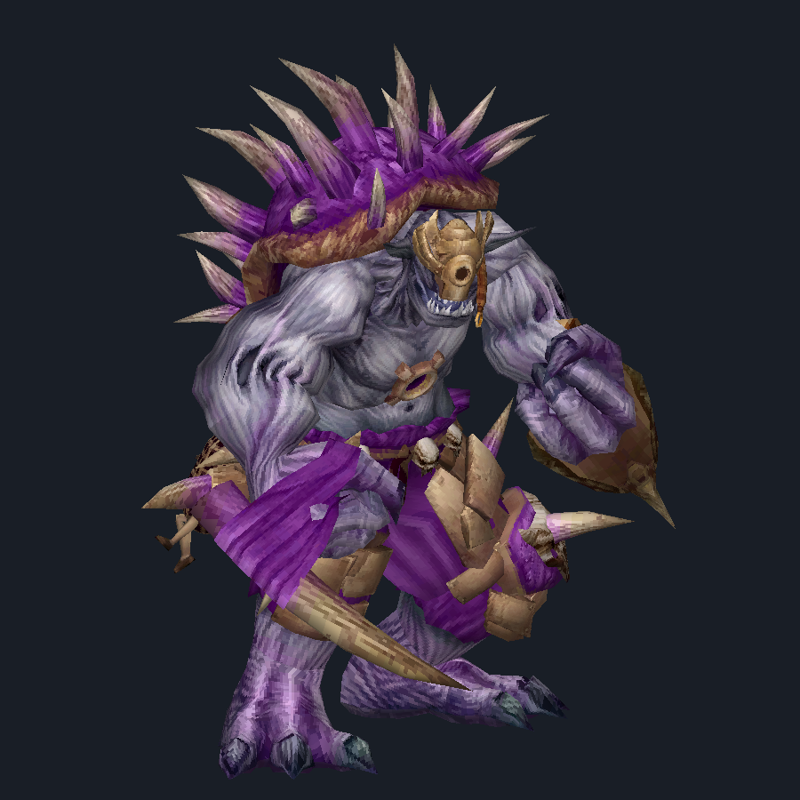
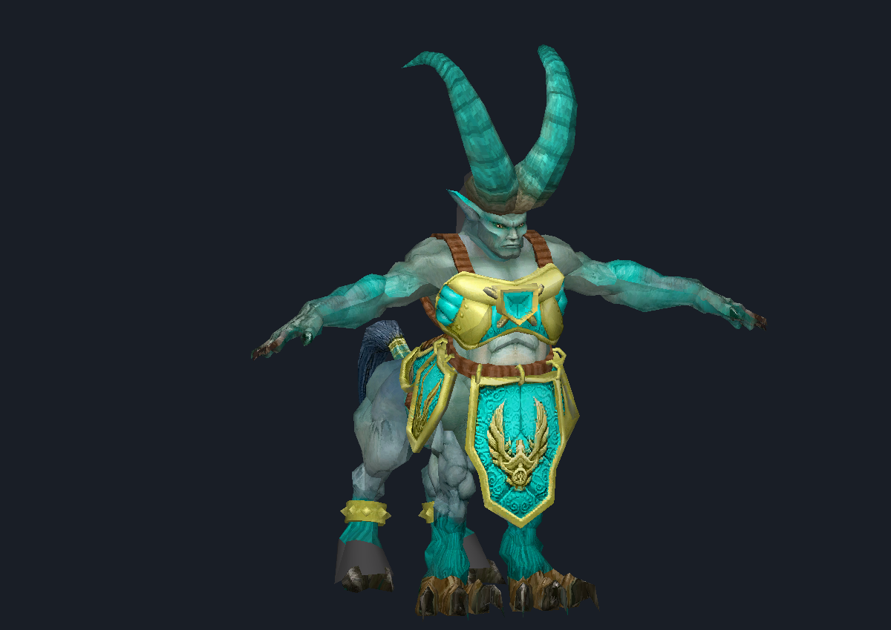
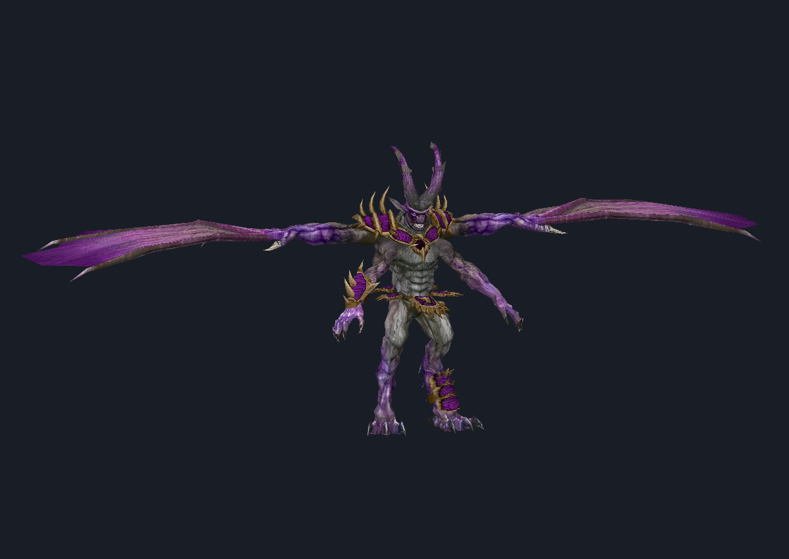

# v2.1 native textures and export categories

Native texture extraction now works on the three supplied Xbox PAKs. These
records did not have PNG/DDS signatures: their compressed image payloads sit
inside named MTX records. PNGs are decoded from those payloads; DDS headers are
constructed around the validated original BC1/BC3 mip data.

| Archive | Texture resources | Mip levels | BC1 | BC3 |
| --- | ---: | ---: | ---: | ---: |
| Cyclops | 102 | 613 | 14 | 88 |
| Centaur | 111 | 668 | 8 | 103 |
| Archdemon | 111 | 689 | 3 | 108 |
| Total | 324 | 1,970 | 25 | 299 |

These totals include particle, interface and other resources, not just character
skins. Archive hashes and metrics are in `previews/texture_audit.json`.





## Record layout established from the supplied bytes

A printable `.mtx` source path is followed by a uint32 name length, the resource
name, a zero uint32, and a fixed 32-byte name. Let R be the fixed-name offset:

| Offset from R | Field |
| --- | --- |
| 0 | Fixed 32-byte name, matching the variable name |
| 32 | Width, uint32 |
| 36 | Height, uint32 |
| 40–54 | Other serialized fields, not fully interpreted |
| 55 | Compressed payload size, uint32 |
| 59 | Observed descriptor value 8, uint32 |
| 63 | Storage code: 65 = BC1, 69 = BC3, uint32 |
| 67 | Observed descriptor value 1, uint32 |
| 71 | Compressed image bytes |

Subsequent mip records start with byte 1 and another fixed name/header. Names,
dimensions, storage codes, exact expected block-compressed sizes, descriptors
and bounds are checked. Mip dimensions halve, clamped to one. Only supported
validated levels are retained; unsupported encodings are not guessed. No
archive-specific offsets are hardcoded.

The Java decoder implements BC1 colors/transparency and both BC3 alpha endpoint
modes. PNG uses standard RGBA, zlib and chunk CRCs. DDS retains every validated
mip level. The independent Python parser/writer plus Pillow's DDS decoder checks
Java PNG pixels and DDS bytes against the original source data, including all
324 supported texture resources. Pixel differences are bounded to at most one
channel unit for integer interpolation rounding.

## Materials and alpha

Model ZIPs contain OBJ, MTL and the native textures referenced by supported
geometry. Material binding uses exact serialized names after case normalization;
it does not assign the nearest texture or substitute alternate LC/DO names.
All material names used by the three primary assemblies resolve to texture maps.
Some alternate parts have no exact texture match and remain untextured.

Source alpha must not automatically be treated as surface opacity. Doing so
made valid Cyclops body surfaces disappear in an initial render check. Therefore:

- `name_offset.png` preserves decoded source RGBA.
- `name_offset.dds` preserves compressed mip data and source alpha.
- Model material bindings use `name_offset_diffuse.png`, with identical RGB and
  opaque alpha. MTL specifies `d 1`; source shader transparency, specular use,
  blending and other alpha-channel semantics are not claimed to be decoded.

The previews use the exported OBJ/MTL/PNG files, a right-handed orthographic
camera, front-face culling, a z-buffer, texture coordinates and generated vertex
normals. Geometry and UVs are not altered to produce the previews.

## Version 2.1 interface (historical)

The app now has Open PAK plus six export buttons:

| Button | Result |
| --- | --- |
| Models | OBJ parts and primary assembly, MTL files and matching textures |
| Textures | Native RGBA PNGs, mipmapped DDS files and an index CSV |
| Rigs (info only) | Explicit unsupported status and string/offset evidence |
| Animation (info only) | Explicit unsupported status and string/offset evidence |
| Everything Else | Validated RIFF/WAVE audio, metadata and untouched original PAK |
| Export Everything | One ZIP containing the same five category ZIPs |

Rigs/animation are **not decoded** by this update. Their buttons cannot create
usable skeletons or clips yet. Export Everything preserves the undecoded bytes
in `other.zip/original/`. A category failure is recorded in that category ZIP
without preventing other categories from being exported. The input is locked
while loading, selecting an export destination or exporting.

Research CSV buttons, browser modes and hex controls have been removed from the
main interface. Reproducible research tools remain in the repository.

Version: Android versionCode 21, versionName 2.1.

## Reproduce and validate

```sh
java com.sun.tools.javac.Main --release 8 -d /tmp/wrath \
  app/src/main/java/com/wrath/pakviewer/WrathGeometry.java \
  app/src/main/java/com/wrath/pakviewer/WrathTextures.java \
  app/src/main/java/com/wrath/pakviewer/WrathMotion.java \
  app/src/main/java/com/wrath/pakviewer/WrathExports.java research/ExportCli.java
java -cp /tmp/wrath ExportCli character.pak textures textures.zip
java -cp /tmp/wrath ExportCli character.pak models models.zip
java -cp /tmp/wrath ExportCli character.pak all everything.zip
python3 research/wrath_textures.py character.pak --out /tmp/dds
python3 research/render_textured.py /tmp/models/models/primary_model.obj --out /tmp/model.png
WRATH_PAK_DIR=/path/to/originals python3 -m unittest discover -s research/tests -v
```

Pillow is required for independent texture tests; preview rendering also requires
NumPy. CI installs Pillow and runs synthetic fixtures; original archives are not
committed. The full local suite has 27 tests, including source texture parity,
material reference resolution, opaque diffuse/source RGB agreement, nested
category ZIP integrity, original-byte preservation, and existing geometry checks.

Remaining: source shader behavior, complete alternate material/variant assembly,
rigs/animation, other native texture layouts and PS2 support, plus on-device v2.1
UI/document-provider verification. This is not a claim of complete asset decoding.
